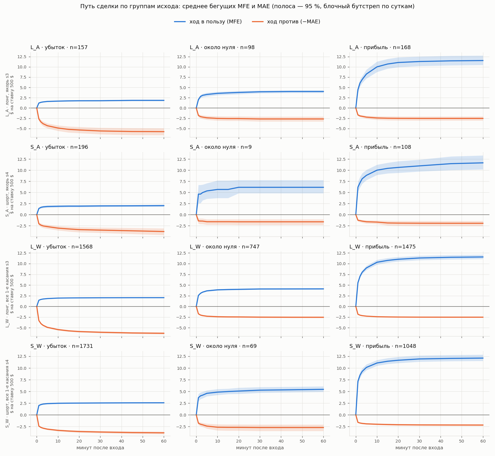
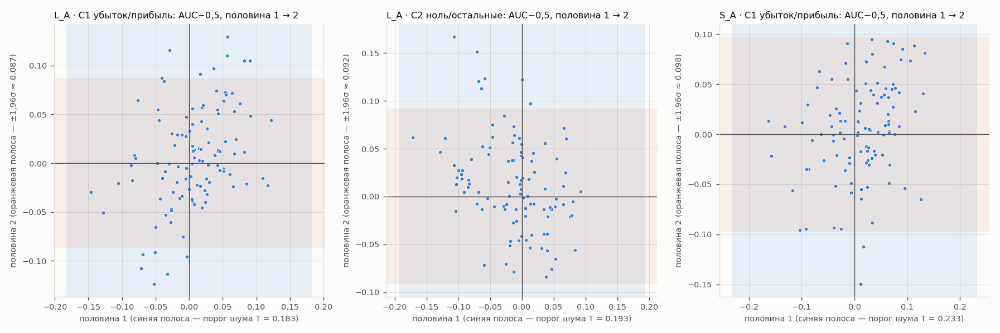

# П-42 (TK-685): сделки по группам «убыток / около нуля / прибыль» — путь после входа и признаки входа, без подгонки (22.11.2026)

Слова владельца (22.11, дословно): «а как нам подобрать такой метод или такое исследование или такой ии или деревянный этот, чтобы мы могли посмотреть на убыточные сделки, глянуть че там пошло не так / нулевые сделки - глянуть что там пошло не так / прибыльные сделки - глянуть что там ТАК и сделать хоть какие то выводы на ОСНОВЕ голых данных без подгонки?»

**Вид — описание готовых сделок. Вердикт записи — «описательно». Торговой рекомендации нет.** Протокол — PS-970 (§13.76 П-42, записан до счёта, L-323) и две поправки до чтения исходов: PS-971 / L-327 (ключ присоединения признаков) и PS-972 / L-328 (ворота ленты). Тексты — `p42-trade-groups-2026-11-22/prereg-13.76.md`, `amend-1.md`, `amend-2.md`; все таблицы отчёта одним файлом — `p42-trade-groups-2026-11-22/tables.md`. Движок не запускался (В-213): взяты готовые сделки TK-643 (якоря: L_A — лонг, стоп 3 %; S_A — шорт, стоп 4 %) и самые широкие наборы TK-674 (L_W — все первые касания, лонг, стоп 3 %; S_W — то же, шорт, стоп 4 %). Окно 01.07–13.11 (136 суток), 775 контрактов, ставка 500 $ (маржа 250 $), после комиссий, фандинг не входит. Половина 1 — 01.07–06.09, половина 2 — 07.09–13.11: всё искалось и обучалось только на половине 1, половина 2 прочитана один раз.

Группа — по результату сделки после комиссий, признаков правило не видит: убыток — результат ниже −комиссии (≈ 0,31 $ за круг), около нуля — в пределах ±комиссии, прибыль — выше +комиссии.

## Ответ

1. **Признаки входа (проверка по PS-970): подтверждённых 0.** 345 проверок одного признака на половине 1 (L_A: 114 + 114, S_A: 117) — ни один не превысил порог шума (0,18–0,23 от 0,5), кандидатов 0. Самые сильные на половине 1 половину 2 не повторили: `dist_bp` у L_A (убыток против прибыли) 0,354 → 0,470; `tfv1800` у L_A (около нуля против остальных) 0,329 → 0,562 — знак сменился; `bigimb300` у S_A 0,337 → 0,513. Дерево глубины 3: качество на обучении 0,760 / 0,764, на половине 2 — 0,516 / 0,503 при пороге 0,615 / 0,621 — не подтвердилось. Вывод: **«край на признаках входа не найден на этих данных»**. Признаки наборов L_W и S_W **не проверялись**: присоединение к матрице признаков 46 % и 70 % при воротах 95 %.
2. **Путь после входа — описание (протокол вердикта по нему не даёт).** Убыточные сделки в среднем ходили в пользу мало, против — много; прибыльные наоборот (всё окно, $ на 500 $; в скобках % маржи):

   | набор | группа | ход в пользу (MFE) | ход против (MAE) |
   |---|---|---:|---:|
   | L_A | убыток | 1,88 $ (0,75 %) | 5,86 $ (2,35 %) |
   | L_A | прибыль | 11,75 $ (4,70 %) | 2,54 $ (1,02 %) |
   | S_A | убыток | 2,08 $ (0,83 %) | 4,08 $ (1,63 %) |
   | S_A | прибыль | 12,13 $ (4,85 %) | 1,96 $ (0,79 %) |

   Почти все убыточные сделки сначала были хотя бы на комиссию в плюсе (L_A 89 %, S_A 97 %; порог — комиссия ≈ 0,31 $, то есть почти любой тик в пользу). Доля «сначала в плюс, потом в минус» у L_A одинакова у убытка и прибыли (40 % и 40 %) — первый ход их не различает; у S_A 34 % и 27 %. По бегущему MFE группы расходятся уже на 3-й минуте (L_A: убыток 1,48 $, прибыль 6,92 $; S_A: 1,75 $ и 8,07 $). Это связано с исходом по построению (группа и есть исход), поэтому это не признак, известный в момент входа, и не правило выхода.
3. **Виды выхода (всё окно).** Убыток L_A: стоп — 29 сделок из 158, −443,42 $ из −684,37 $ (65 %); S_A: стоп — 13 из 197, −162,12 $ из −387,47 $ (42 %). Остальной убыток — выход «возврат за уровень» (`rt`): L_A 102 сделки, −229,11 $; S_A 184 сделки, −225,35 $. Прибыль — трейл (L_A 157 из 171, S_A 112 из 113); около нуля — безубыток (L_A 84 из 99).
4. **Половины (§3, интервалов у этих чисел нет).** L_A: MFE убытка 1,85 / 1,90 $ (половина 1 / 2), MAE убытка 6,22 / 5,55 $, MFE прибыли 11,51 / 11,96 $; у S_A расхождение больше — MFE прибыли 13,61 / 10,65 $, MAE убытка 4,41 / 3,75 $, время до MFE убытка 7,63 / 26,03 мин. P&L половин — «найдено на этих данных» (стопы 3 % / 4 % выбирались на всём окне, включая половину 2): L_A +76,94 → +178,15 $; S_A +76,74 → +93,67 $; L_W +323,15 → −339,67 $ (просадка 449,65 $ = 179,86 % маржи); S_W +802,43 → +301,04 $.

## Что покрыто правилом PS-970, а что только описано

| часть | правило вердикта PS-970 | как читать |
|---|---|---|
| тесты признаков L_A (2 контраста), S_A (контраст «убыток / прибыль») | есть (§6): порог шума, подтверждение на половине 2 | 0 подтверждено |
| дерево глубины 3, L_A и S_A | есть (§7): порог по перемешанным меткам | не подтвердилось |
| CatBoost, L_A и S_A | нет («вердикта по модели нет») | справочно |
| путь сделки, бегущие MFE / MAE, виды выходов, размеры групп | нет («путь не проверяет гипотез и не имеет вердикта», §4) | описательно |
| сделки, Σ $, Шарп, просадка, перехай по половинам | нет: выбор стопов и наборов видел половину 2 (§1) | «найдено на этих данных», не проверка вперёд |
| тесты признаков L_W, S_W; S_A «около нуля против остальных» | **не запускались** | L_W / S_W — не прошли ворота присоединения; S_A около нуля — 7 и 2 сделки на половинах, меньше 30 |

## 1. Ворота

| набор | G-ref (n, Σ) | G-tape | G-tape-entry (точная (без проскальзывания)) | G-join | строка матрицы: без дубля / по цене / нет строки |
|---|---|---|---|---|---|
| L_A | сошлись | 423 / 428 = 98,83 % | 100,00 % | 427 / 428 = 99,77 % (прошёл) | 407 / 20 / 1 |
| S_A | сошлись | 313 / 319 = 98,12 % | 99,68 % | 317 / 319 = 99,37 % (прошёл) | 292 / 25 / 2 |
| L_W | сошлись | 3790 / 3875 = 97,81 % | 99,84 % | 1770 / 3875 = 45,68 % (НЕ прошёл) | 1709 / 61 / 2105 |
| S_W | сошлись | 2848 / 2912 = 97,80 % | 99,89 % | 2040 / 2912 = 70,05 % (НЕ прошёл) | 1966 / 74 / 872 |

- G-ref — число сделок и Σ равны летописи. G-tape (путь посчитан у ≥ 97 % сделок набора, порог по PS-972; прежние 99 % не проходил ни один набор — у 21–23 монет нет суток ленты в складе; правка записана до чтения путей по группам и половины 2). G-tape-entry — точная проверка: цена входа без проскальзывания движка (0,01 % на ногу) лежит внутри [min, max] ленты за ±1 с от входа (≥ 95 %); запасной допуск 0,015 % не понадобился.
- G-join (≥ 95 % сделок набора присоединены к матрице признаков TK-671; ключ без `level` и выбор строки дубля по цене — PS-971): L_A 99,77 % и S_A 99,37 % прошли; **L_W 45,68 % и S_W 70,05 % не прошли — признаки этих наборов не считались**, у них нет сигналов в матрице (другой прогон движка).

## 2. Метрики наборов по половинам

Шарп — годовой по дневному P&L (день выхода, все 136 суток); просадка — $ и % маржи 250 $; перехай — сутки между новыми максимумами P&L (самый длинный / средний / хвост); R:R — средний выигрыш ÷ |средний проигрыш|. Σ, Шарп и перехай половин — «найдено на этих данных».

| набор | период | сделок | Σ $ | $ на сделку | Шарп | просадка $ | просадка % маржи | перехай, сут (длинный / средний / хвост) | R:R |
|---|---|---|---|---|---|---|---|---|---|
| L_A | половина 1 (01.07–06.09) | 205 | 76,94 | 0,38 | 2,29 | 61,87 | 24,75 | 28 / 3,6 / 7 | 1,25 |
| L_A | половина 2 (07.09–13.11) | 223 | 178,15 | 0,80 | 4,39 | 55,08 | 22,03 | 15 / 3,5 / 2 | 1,69 |
| L_A | всё окно | 428 | 255,09 | 0,60 | 3,43 | 61,87 | 24,75 | 28 / 4,1 / 2 | 1,46 |
| S_A | половина 1 (01.07–06.09) | 166 | 76,74 | 0,46 | 2,50 | 33,79 | 13,52 | 23 / 4,1 / 23 | 2,07 |
| S_A | половина 2 (07.09–13.11) | 153 | 93,67 | 0,61 | 4,17 | 25,30 | 10,12 | 15 / 4,5 / 1 | 2,77 |
| S_A | всё окно | 319 | 170,41 | 0,53 | 3,18 | 33,79 | 13,52 | 40 / 6,1 / 1 | 2,36 |
| L_W | половина 1 (01.07–06.09) | 1916 | 323,15 | 0,17 | 2,71 | 113,81 | 45,52 | 20 / 4,0 / 20 | 1,19 |
| L_W | половина 2 (07.09–13.11) | 1959 | −339,67 | −0,17 | −2,76 | 449,65 | 179,86 | 67 / 1,0 / 67 | 1,12 |
| L_W | всё окно | 3875 | −16,52 | −0,00 | −0,07 | 469,73 | 187,89 | 88 / 4,0 / 88 | 1,15 |
| S_W | половина 1 (01.07–06.09) | 1531 | 802,43 | 0,52 | 9,73 | 63,61 | 25,44 | 19 / 1,9 / 0 | 2,26 |
| S_W | половина 2 (07.09–13.11) | 1381 | 301,04 | 0,22 | 4,16 | 151,77 | 60,71 | 27 / 2,9 / 8 | 1,98 |
| S_W | всё окно | 2912 | 1103,46 | 0,38 | 7,04 | 151,77 | 60,71 | 27 / 2,3 / 8 | 2,13 |

## 3. Путь по группам: половина 1 рядом с половиной 2

Путь считан по ленте тиков склада TK-599 от входа до выхода, позиция 500 $ без частичных закрытий. MFE / MAE — средний наибольший ход в пользу / против, $ на ставку 500 $ и % маржи 250 $. «Сделок: всего / с лентой» — сделки группы и сделки с лентой (у остальных нет суток ленты, в путь не входят); Σ $ и $ на сделку — по всем сделкам группы. «Отдано от MFE» — доля наибольшего хода, отданная к выходу, только у «зелёных» сделок (MFE не меньше комиссии); у убыточных больше 100 %, потому что выход ниже цены входа. «В плюсе до минуса» — доля сделок, у которых первый ход в пользу на комиссию случился раньше первого хода против на комиссию. Виды выхода по половинам в таблицах не посчитаны (§10); за всё окно — §4.

### L_A — лонг, якорь (стоп 3 %)

| группа | период | сделок: всего / с лентой | Σ $ | $ на сделку | MFE $ (% маржи) | MAE $ (% маржи) | отдано от MFE, % (зелёные) | в плюсе до минуса, % | зелёных, % | до MFE / до MAE, мин | удержание, мин |
|---|---|---:|---:|---:|---:|---:|---:|---:|---:|---:|---:|
| убыток | пол. 1 (01.07–06.09) | 75 / 74 | −352,56 | −4,70 | 1,85 (0,74 %) | 6,22 (2,49 %) | 318 | 39,19 | 85,14 | 4,09 / 5,87 | 8,43 |
| убыток | пол. 2 (07.09–13.11) | 83 / 83 | −331,80 | −4,00 | 1,90 (0,76 %) | 5,55 (2,22 %) | 391 | 40,96 | 92,77 | 7,55 / 12,71 | 17,46 |
| убыток | всё окно | 158 / 157 | −684,37 | −4,33 | 1,88 (0,75 %) | 5,86 (2,35 %) | 358 | 40,13 | 89,17 | 5,92 / 9,49 | 13,20 |
| около нуля | пол. 1 (01.07–06.09) | 49 / 48 | −1,83 | −0,04 | 4,41 (1,77 %) | 2,82 (1,13 %) | 98 | 37,50 | 100,00 | 6,64 / 2,56 | 7,75 |
| около нуля | пол. 2 (07.09–13.11) | 50 / 50 | −3,84 | −0,08 | 3,72 (1,49 %) | 2,51 (1,01 %) | 100 | 26,00 | 100,00 | 5,69 / 1,79 | 7,48 |
| около нуля | всё окно | 99 / 98 | −5,67 | −0,06 | 4,06 (1,62 %) | 2,66 (1,06 %) | 99 | 31,63 | 100,00 | 6,15 / 2,16 | 7,61 |
| прибыль | пол. 1 (01.07–06.09) | 81 / 78 | 431,33 | 5,33 | 11,51 (4,60 %) | 3,10 (1,24 %) | 60 | 38,46 | 100,00 | 15,24 / 3,11 | 16,99 |
| прибыль | пол. 2 (07.09–13.11) | 90 / 90 | 513,80 | 5,71 | 11,96 (4,79 %) | 2,06 (0,82 %) | 54 | 41,11 | 100,00 | 8,34 / 1,40 | 10,22 |
| прибыль | всё окно | 171 / 168 | 945,13 | 5,53 | 11,75 (4,70 %) | 2,54 (1,02 %) | 56 | 39,88 | 100,00 | 11,55 / 2,19 | 13,36 |

### S_A — шорт, якорь (стоп 4 %)

| группа | период | сделок: всего / с лентой | Σ $ | $ на сделку | MFE $ (% маржи) | MAE $ (% маржи) | отдано от MFE, % (зелёные) | в плюсе до минуса, % | зелёных, % | до MFE / до MAE, мин | удержание, мин |
|---|---|---:|---:|---:|---:|---:|---:|---:|---:|---:|---:|
| убыток | пол. 1 (01.07–06.09) | 100 / 99 | −230,88 | −2,31 | 1,84 (0,74 %) | 4,41 (1,76 %) | 571 | 40,40 | 96,97 | 7,63 / 32,84 | 38,60 |
| убыток | пол. 2 (07.09–13.11) | 97 / 97 | −156,58 | −1,61 | 2,31 (0,93 %) | 3,75 (1,50 %) | 222 | 27,84 | 96,91 | 26,03 / 17,11 | 31,16 |
| убыток | всё окно | 197 / 196 | −387,47 | −1,97 | 2,08 (0,83 %) | 4,08 (1,63 %) | 398 | 34,18 | 96,94 | 16,73 / 25,05 | 34,92 |
| около нуля | пол. 1 (01.07–06.09) | 7 / 7 | 0,42 | 0,06 | 5,94 (2,38 %) | 1,20 (0,48 %) | 101 | 14,29 | 100,00 | 0,29 / 1,00 | 1,92 |
| около нуля | пол. 2 (07.09–13.11) | 2 / 2 | 0,32 | 0,16 | 6,89 (2,75 %) | 3,03 (1,21 %) | 99 | 0,00 | 100,00 | 12,67 / 8,27 | 18,21 |
| около нуля | всё окно | 9 / 9 | 0,74 | 0,08 | 6,15 (2,46 %) | 1,61 (0,64 %) | 100 | 11,11 | 100,00 | 3,04 / 2,62 | 5,54 |
| прибыль | пол. 1 (01.07–06.09) | 59 / 54 | 307,21 | 5,21 | 13,61 (5,44 %) | 1,98 (0,79 %) | 49 | 27,78 | 100,00 | 13,14 / 1,46 | 15,57 |
| прибыль | пол. 2 (07.09–13.11) | 54 / 54 | 249,93 | 4,63 | 10,65 (4,26 %) | 1,95 (0,78 %) | 50 | 25,93 | 100,00 | 14,36 / 2,62 | 17,22 |
| прибыль | всё окно | 113 / 108 | 557,14 | 4,93 | 12,13 (4,85 %) | 1,96 (0,79 %) | 49 | 26,85 | 100,00 | 13,75 / 2,04 | 16,40 |

### L_W — лонг, самый широкий набор (все первые касания, стоп 3 %)

| группа | период | сделок: всего / с лентой | Σ $ | $ на сделку | MFE $ (% маржи) | MAE $ (% маржи) | отдано от MFE, % (зелёные) | в плюсе до минуса, % | зелёных, % | до MFE / до MAE, мин | удержание, мин |
|---|---|---:|---:|---:|---:|---:|---:|---:|---:|---:|---:|
| убыток | пол. 1 (01.07–06.09) | 765 / 738 | −3697,58 | −4,83 | 2,08 (0,83 %) | 6,18 (2,47 %) | 449 | 31,17 | 91,87 | 3,44 / 7,81 | 9,86 |
| убыток | пол. 2 (07.09–13.11) | 832 / 830 | −4285,02 | −5,15 | 2,02 (0,81 %) | 6,60 (2,64 %) | 544 | 30,00 | 91,57 | 3,20 / 10,39 | 12,24 |
| убыток | всё окно | 1597 / 1568 | −7982,60 | −5,00 | 2,05 (0,82 %) | 6,40 (2,56 %) | 499 | 30,55 | 91,71 | 3,31 / 9,18 | 11,12 |
| около нуля | пол. 1 (01.07–06.09) | 384 / 369 | −19,81 | −0,05 | 4,33 (1,73 %) | 2,53 (1,01 %) | 99 | 34,96 | 100,00 | 4,80 / 1,72 | 5,96 |
| около нуля | пол. 2 (07.09–13.11) | 378 / 378 | −21,54 | −0,06 | 3,97 (1,59 %) | 2,58 (1,03 %) | 98 | 34,13 | 100,00 | 6,74 / 2,84 | 7,99 |
| около нуля | всё окно | 762 / 747 | −41,35 | −0,05 | 4,15 (1,66 %) | 2,56 (1,02 %) | 99 | 34,54 | 100,00 | 5,78 / 2,28 | 6,99 |
| прибыль | пол. 1 (01.07–06.09) | 767 / 726 | 4040,55 | 5,27 | 11,68 (4,67 %) | 2,57 (1,03 %) | 59 | 31,27 | 100,00 | 7,16 / 1,49 | 8,38 |
| прибыль | пол. 2 (07.09–13.11) | 749 / 749 | 3966,89 | 5,30 | 11,68 (4,67 %) | 2,49 (1,00 %) | 56 | 32,31 | 100,00 | 8,12 / 2,03 | 9,45 |
| прибыль | всё окно | 1516 / 1475 | 8007,43 | 5,28 | 11,68 (4,67 %) | 2,53 (1,01 %) | 58 | 31,80 | 100,00 | 7,65 / 1,76 | 8,93 |

### S_W — шорт, самый широкий набор (все первые касания, стоп 4 %)

| группа | период | сделок: всего / с лентой | Σ $ | $ на сделку | MFE $ (% маржи) | MAE $ (% маржи) | отдано от MFE, % (зелёные) | в плюсе до минуса, % | зелёных, % | до MFE / до MAE, мин | удержание, мин |
|---|---|---:|---:|---:|---:|---:|---:|---:|---:|---:|---:|
| убыток | пол. 1 (01.07–06.09) | 918 / 882 | −1869,47 | −2,04 | 2,70 (1,08 %) | 3,83 (1,53 %) | 325 | 30,27 | 96,71 | 4,60 / 8,23 | 11,48 |
| убыток | пол. 2 (07.09–13.11) | 849 / 849 | −1767,35 | −2,08 | 2,52 (1,01 %) | 4,08 (1,63 %) | 364 | 29,33 | 96,23 | 4,89 / 6,51 | 9,65 |
| убыток | всё окно | 1767 / 1731 | −3636,82 | −2,06 | 2,61 (1,04 %) | 3,95 (1,58 %) | 344 | 29,81 | 96,48 | 4,75 / 7,39 | 10,58 |
| около нуля | пол. 1 (01.07–06.09) | 32 / 32 | −1,55 | −0,05 | 5,18 (2,07 %) | 3,05 (1,22 %) | 101 | 37,50 | 100,00 | 19,22 / 7,32 | 22,44 |
| около нуля | пол. 2 (07.09–13.11) | 37 / 37 | −0,19 | −0,01 | 5,77 (2,31 %) | 2,41 (0,96 %) | 98 | 27,03 | 100,00 | 4,91 / 1,44 | 7,00 |
| около нуля | всё окно | 69 / 69 | −1,74 | −0,03 | 5,50 (2,20 %) | 2,71 (1,08 %) | 100 | 31,88 | 100,00 | 11,55 / 4,17 | 14,16 |
| прибыль | пол. 1 (01.07–06.09) | 581 / 553 | 2673,45 | 4,60 | 12,71 (5,09 %) | 2,16 (0,86 %) | 54 | 31,28 | 100,00 | 8,43 / 1,71 | 9,65 |
| прибыль | пол. 2 (07.09–13.11) | 495 / 495 | 2068,57 | 4,18 | 11,98 (4,79 %) | 2,23 (0,89 %) | 55 | 29,09 | 100,00 | 9,14 / 2,92 | 10,60 |
| прибыль | всё окно | 1076 / 1048 | 4742,02 | 4,41 | 12,37 (4,95 %) | 2,19 (0,88 %) | 54 | 30,25 | 100,00 | 8,77 / 2,28 | 10,10 |

График бегущих MFE и MAE по группам и наборам (всё окно, полоса 95 % — блочный бутстреп по суткам): 

## 4. Виды выхода × группа (всё окно)

`rt` — возврат за уровень, `be` — безубыток, `trail` — трейл, `stop` — жёсткий стоп. «$ на сделку» и «доля Σ группы» — арифметика по напечатанным n и Σ.

| набор | группа | вид выхода | сделок | Σ $ | $ на сделку | доля Σ группы, % |
|---|---|---|---:|---:|---:|---:|
| L_A | убыток | be | 27 | −11,85 | −0,44 | 2 |
| L_A | убыток | rt | 102 | −229,11 | −2,25 | 33 |
| L_A | убыток | stop | 29 | −443,42 | −15,29 | 65 |
| L_A | около нуля | be | 84 | −4,59 | −0,05 | — |
| L_A | около нуля | rt | 8 | −1,42 | −0,18 | — |
| L_A | около нуля | trail | 7 | 0,35 | 0,05 | — |
| L_A | прибыль | be | 13 | 16,49 | 1,27 | 2 |
| L_A | прибыль | rt | 1 | 0,76 | 0,76 | 0 |
| L_A | прибыль | trail | 157 | 927,88 | 5,91 | 98 |
| S_A | убыток | rt | 184 | −225,35 | −1,22 | 58 |
| S_A | убыток | stop | 13 | −162,12 | −12,47 | 42 |
| S_A | около нуля | rt | 5 | 0,49 | 0,10 | — |
| S_A | около нуля | trail | 4 | 0,25 | 0,06 | — |
| S_A | прибыль | rt | 1 | 2,65 | 2,65 | 0 |
| S_A | прибыль | trail | 112 | 554,50 | 4,95 | 100 |
| L_W | убыток | be | 221 | −146,15 | −0,66 | 2 |
| L_W | убыток | rt | 1007 | −2360,58 | −2,34 | 30 |
| L_W | убыток | stop | 357 | −5465,68 | −15,31 | 68 |
| L_W | убыток | trail | 12 | −10,19 | −0,85 | 0 |
| L_W | около нуля | be | 681 | −41,19 | −0,06 | — |
| L_W | около нуля | rt | 38 | −3,82 | −0,10 | — |
| L_W | около нуля | trail | 43 | 3,66 | 0,09 | — |
| L_W | прибыль | be | 236 | 395,29 | 1,67 | 5 |
| L_W | прибыль | rt | 6 | 6,88 | 1,15 | 0 |
| L_W | прибыль | trail | 1274 | 7605,27 | 5,97 | 95 |
| S_W | убыток | rt | 1657 | −2370,76 | −1,43 | 65 |
| S_W | убыток | stop | 105 | −1261,72 | −12,02 | 35 |
| S_W | убыток | trail | 5 | −4,34 | −0,87 | 0 |
| S_W | около нуля | rt | 52 | −3,51 | −0,07 | — |
| S_W | около нуля | trail | 17 | 1,77 | 0,10 | — |
| S_W | прибыль | rt | 15 | 16,25 | 1,08 | 0 |
| S_W | прибыль | trail | 1061 | 4725,77 | 4,45 | 100 |

## 5. Бегущие MFE и MAE на отметках (всё окно, среднее, $ на ставку 500 $; число — минуты после входа)

| набор | группа | сделок | MFE 1 | MFE 3 | MFE 5 | MFE 10 | MFE 30 | MFE 60 | MAE 1 | MAE 3 | MAE 5 | MAE 10 | MAE 30 | MAE 60 |
|---|---|---|---|---|---|---|---|---|---|---|---|---|---|---|
| L_A | убыток | 157 | 1,21 | 1,48 | 1,60 | 1,68 | 1,77 | 1,85 | 2,67 | 3,82 | 4,30 | 4,87 | 5,58 | 5,75 |
| L_A | около нуля | 98 | 2,04 | 3,08 | 3,29 | 3,56 | 3,94 | 4,01 | 1,81 | 2,21 | 2,37 | 2,53 | 2,66 | 2,66 |
| L_A | прибыль | 168 | 4,47 | 6,92 | 8,25 | 10,00 | 11,30 | 11,53 | 1,68 | 2,03 | 2,22 | 2,42 | 2,53 | 2,53 |
| S_A | убыток | 196 | 1,39 | 1,75 | 1,84 | 1,89 | 1,97 | 2,03 | 2,05 | 2,53 | 2,69 | 3,02 | 3,47 | 3,79 |
| S_A | около нуля | 9 | 4,62 | 4,97 | 5,34 | 5,67 | 6,15 | 6,15 | 1,40 | 1,44 | 1,59 | 1,59 | 1,61 | 1,61 |
| S_A | прибыль | 108 | 6,20 | 8,07 | 8,84 | 10,00 | 10,97 | 11,65 | 1,25 | 1,45 | 1,59 | 1,67 | 1,92 | 1,93 |
| L_W | убыток | 1568 | 1,44 | 1,73 | 1,83 | 1,94 | 2,02 | 2,04 | 3,30 | 4,43 | 4,90 | 5,42 | 6,05 | 6,29 |
| L_W | около нуля | 747 | 2,56 | 3,34 | 3,64 | 3,87 | 4,07 | 4,10 | 1,73 | 2,15 | 2,29 | 2,41 | 2,51 | 2,54 |
| L_W | прибыль | 1475 | 5,55 | 7,98 | 9,00 | 10,32 | 11,32 | 11,56 | 1,84 | 2,16 | 2,28 | 2,41 | 2,51 | 2,52 |
| S_W | убыток | 1731 | 2,01 | 2,32 | 2,41 | 2,48 | 2,55 | 2,59 | 2,40 | 2,83 | 3,04 | 3,30 | 3,65 | 3,83 |
| S_W | около нуля | 69 | 3,67 | 4,21 | 4,60 | 4,85 | 5,28 | 5,45 | 1,77 | 2,11 | 2,39 | 2,63 | 2,70 | 2,70 |
| S_W | прибыль | 1048 | 7,17 | 9,27 | 10,13 | 11,07 | 11,94 | 12,12 | 1,60 | 1,81 | 1,91 | 1,99 | 2,13 | 2,17 |

## 6. Признаки входа: половина 1 → половина 2

AUC одного признака внутри набора: вероятность, что значение у метки 1 больше, чем у метки 0 (0,5 — без различия). Контраст C1 — убыток против прибыли, C2 — около нуля против остальных. Порог T — квантиль шума (перестановки меток и сдвиг по времени, поправка на число признаков), кандидат — |AUC − 0,5| > T на половине 1. Признаки с окном больше 60 мин исключены до счёта (222 из 305 остались, пригодных m_f — в таблице).

| набор | контраст | метка 1 / всего (пол. 1) | метка 1 / всего (пол. 2) | m_f | порог T | кандидатов c | подтверждено | самый сильный на половине 1 |
|---|---|---|---|---|---|---|---|---|
| L_A | C1 убыток / прибыль | 74 / 155 | 83 / 173 | 114 | 0,1829 | 0 | 0 | dist_bp (№ 141): AUC1 0,354, AUC2 0,470 |
| L_A | C2 около нуля / остальные | 49 / 204 | 50 / 223 | 114 | 0,1933 | 0 | 0 | tfv1800 (№ 110): AUC1 0,329, AUC2 0,562 |
| S_A | C1 убыток / прибыль | 99 / 158 | 97 / 150 | 117 | 0,2328 | 0 | 0 | bigimb300 (№ 190): AUC1 0,337, AUC2 0,513 |
| S_A | C2 около нуля / остальные | 7 / 165 | 2 / 152 | 117 | не тестируется (группа < 30) | — | — |  |

Графика подтверждённых признаков нет (подтверждённых 0). Диагностика «половина 1 против половины 2» по всем признакам с линиями шума: 

## 7. Дерево глубины 3 и CatBoost (контраст «убыток / прибыль», обучение на половине 1)

**L_A.** AUC обучения (пол. 1) 0,760; AUC половины 2 0,516; порог 0,5 + z·σ_null = 0,615 (σ_null 0,0459) → не подтвердилось. Правила (листья — доля убытков):

```
mk_own_s60 ≤ 0.0252316:
  gap60_s ≤ 17.4018:
    лист 2: n=32, доля убытков 0.156
  gap60_s > 17.4018:
    лист 3: n=22, доля убытков 0.455
mk_own_s60 > 0.0252316:
  cons60 ≤ 0:
    лист 5: n=37, доля убытков 0.378
  cons60 > 0:
    mv60 ≤ 8.54604:
      лист 7: n=38, доля убытков 0.842
    mv60 > 8.54604:
      лист 8: n=26, доля убытков 0.500
```
| лист | сделок пол. 1 | доля убытков пол. 1 | сделок пол. 2 | доля убытков пол. 2 |
|---|---|---|---|---|
| 2 | 32 | 0,156 | 46 | 0,478 |
| 3 | 22 | 0,455 | 22 | 0,591 |
| 5 | 37 | 0,378 | 25 | 0,400 |
| 7 | 38 | 0,842 | 50 | 0,520 |
| 8 | 26 | 0,500 | 30 | 0,400 |

CatBoost (справочно, без вердикта): AUC половины 2 0,518; модели на перемешанных метках 0,503 ± 0,045; перекрытие топ-20 mean|SHAP| половин 19 из 20, ранговая корреляция 0,99. Топ-5 половины 1: mk_rv5_btc_60 (вне страницы), mk_own_s60 (вне страницы), dist_bp (№ 141), natr_bp (№ 105), msz_r (№ 121).

**S_A.** AUC обучения (пол. 1) 0,764; AUC половины 2 0,503; порог 0,5 + z·σ_null = 0,621 (σ_null 0,0486) → не подтвердилось. Правила (листья — доля убытков):

```
bigimb300 ≤ 0.165876:
  gap60_s ≤ 12.4838:
    лист 2: n=22, доля убытков 0.727
  gap60_s > 12.4838:
    лист 3: n=26, доля убытков 0.962
bigimb300 > 0.165876:
  cons60 ≤ 1:
    mv15 ≤ 3.19292:
      лист 6: n=36, доля убытков 0.278
    mv15 > 3.19292:
      лист 7: n=43, доля убытков 0.581
  cons60 > 1:
    лист 8: n=31, доля убытков 0.742
```
| лист | сделок пол. 1 | доля убытков пол. 1 | сделок пол. 2 | доля убытков пол. 2 |
|---|---|---|---|---|
| 2 | 22 | 0,727 | 22 | 0,545 |
| 3 | 26 | 0,962 | 17 | 0,765 |
| 6 | 36 | 0,278 | 28 | 0,679 |
| 7 | 43 | 0,581 | 46 | 0,652 |
| 8 | 31 | 0,742 | 37 | 0,622 |

CatBoost (справочно, без вердикта): AUC половины 2 0,568; модели на перемешанных метках 0,495 ± 0,049; перекрытие топ-20 mean|SHAP| половин 18 из 20, ранговая корреляция 0,99. Топ-5 половины 1: bigimb300 (№ 190), dls_ts (№ 131), msz_r (№ 121), tfv60 (№ 108), maxmv1 (№ 158).

CatBoost — справочно: на S_A AUC половины 2 (0,568) выше, чем на перемешанных метках (0,495 ± 0,049), у L_A (0,518) — в пределах шума (0,503 ± 0,045); вердикта по модели протокол не даёт, и подтверждёнными признаками это не становится.

## 8. Сделки без ленты

| набор | исключено | по группам (всё окно): убыток / около нуля / прибыль | монет | монета-суток |
|---|---|---|---|---|
| L_A | 5 | 1 / 1 / 3 | 2 | 5 |
| S_A | 6 | 1 / 0 / 5 | 4 | 6 |
| L_W | 85 | 29 / 15 / 41 | 23 | 67 |
| S_W | 64 | 36 / 0 / 28 | 21 | 52 |

Исключены только из путей (нет суток ленты у монеты); в группах, Σ и тестах признаков эти сделки остаются. Перечень «монета, дата, число сделок» — `p42-trade-groups-2026-11-22/tables.md`, раздел «Лента: исключённые сделки». Откуда движок брал цены этих монет в эти сутки, не установлено (в каталогах окон `aggtrades` и `cache` нет, например, RIFUSDT и VANRYUSDT); склад не сверялся.

## 9. Счётчик испытаний

- Проверок одного признака на половине 1: **345** (L_A C1 114, L_A C2 114, S_A C1 117). Поправка на число признаков — семейная (Westfall–Young), α на проверку набора и контраста 0,05 / 8; она не ослаблялась после того, как 5 из 8 проверок выпали (L_W и S_W по воротам, S_A C2 по размеру группы).
- Деревьев 2 (L_A, S_A), CatBoost 2 (справочно). Путь — описание, не испытания.
- «Найдено на этих данных» относится ко всем P&L-числам наборов (выбор стопов и самих наборов видел половину 2), к сильнейшим признакам половины 1 в §6 и к отметкам путей.

## 10. Чего нет в числах (не считалось, чтобы не открывать половину 2 заново)

- **Виды выходов по половинам** — в таблицах только за всё окно (§4).
- **Σ $ и $ на сделку только по сделкам с лентой** — в таблицах они по всем сделкам группы (§3, колонка «всего / с лентой»).
- **Интервалы у чисел пути** — в таблицах их нет, полоса 95 % только на графике.
- **По месяцам (август, сентябрь)** — таблиц нет: протокол делит окно на половины.
- **Признаки L_W и S_W**, деревья и CatBoost на них — не считались (ворота присоединения).
- **Стопы 3 % / 4 %** выбраны на всём окне, включая половину 2 (утечка выбора наборов); P&L половин — «найдено на этих данных».

## 11. Вердикт по PS-970

Запись — **«описательно»**: подтверждённых признаков 0, деревья не подтвердились — «край на признаках входа не найден на этих данных». Всё остальное (путь, виды выходов, метрики наборов, CatBoost) — описание готовых сделок, не проверка вперёд. Торговой рекомендации нет.

Отступления: поправка 1 (ключ присоединения, PS-971 / L-327) и поправка 2 (ворота ленты, PS-972 / L-328) — обе записаны в летопись до чтения исходов и половины 2; критик `thr_m27kv64m9h` — PASS.

## Дальше

Гипотеза, не вывод и не рекомендация: годится ли ранний путь (например, бегущий MFE на 3-й минуте) как правило выхода. Не проверялась; проверять — только новым протоколом до счёта.
